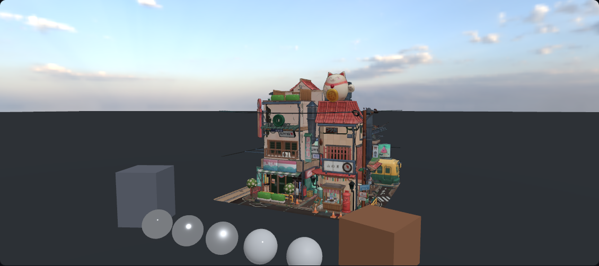
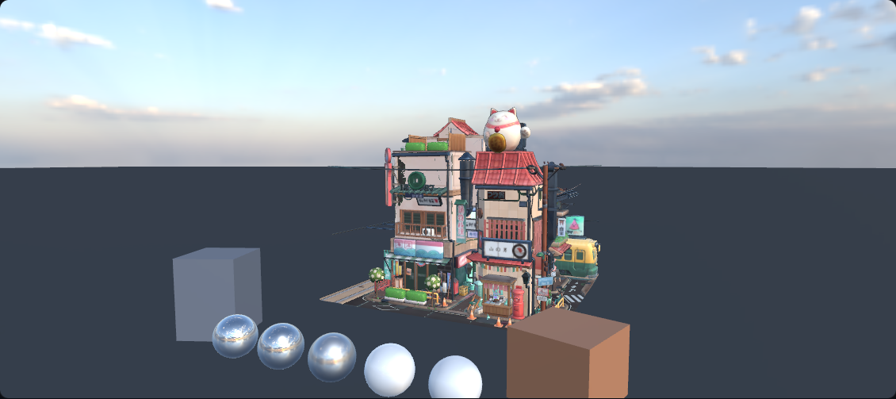
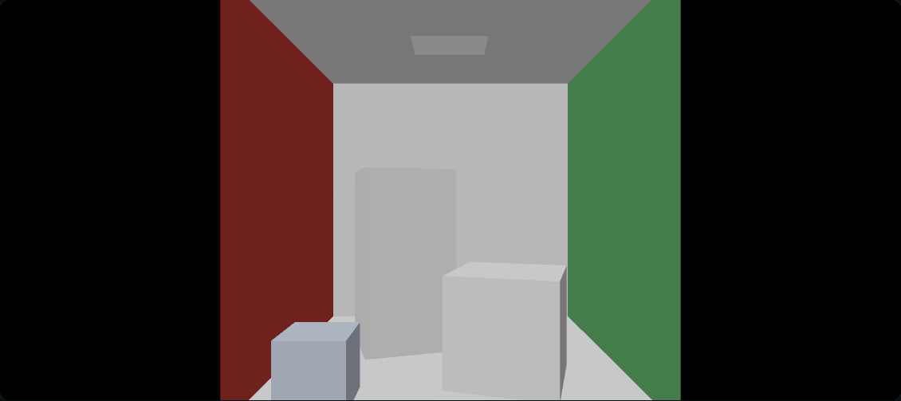

# Case Study：从 G-buffer 到 HDRI IBL

一个用 WebGL2 / three.js 自建 pass 链的实时渲染实验。目标不是「把模型放进 three.js」，而是把 **MRT、PBR、IBL、HDR 链路** 连成一条能验证、能讲清取舍的管线。

| IBL 关 | IBL 开 |
| --- | --- |
|  |  |

---

## 1. 问题与约束

作品集如果只有「加载了一个 HDRI、模型看起来不错」，很难证明渲染能力。这里给自己定的约束是：

1. **中间量必须可见**：G-buffer 三个附件、HDR 链路、逐 pass 计时都能在 demo 里打开，而不是只放最终截图。
2. **正确性必须可测**：Cornell Box 作为已知几何参考；白炉中心亮度要有数字，不能只说「实现了 IBL」。
3. **真实资产必须进同一条管线**：LittlestTokyo 带 Draco、蒙皮、baseColor 贴图、BLEND 玻璃；不能为了跑通而退回内建材质。
4. **状态必须可复现**：曝光、曲线、场景、IBL、白炉、演示模式全部进 URL query。

当前范围是 **直接光 + IBL**，不是完整 GI。阴影、SSR、SSGI、Sponza 室内在 roadmap 中，文中会明确标注。

---

## 2. 渲染链路

```text
three.js 场景
  ├─ GBufferMaterial（场景物体，3 个 fragment output）
  └─ SkyMaterial（天空球，3 个 fragment output）
        │
        ▼
BeautyPass：gAlbedo（最终着色）/ gNormal / gMRAO + depth
        │
        ├─ G-buffer 调试视图（直接看原始附件）
        ▼
HDRPipeline：luminance（测光 / 白炉读数）→ bloom → tonemap-output
        │
        ▼
canvas（sRGB）
```

自建链和「场景直出」共用同一批材质；A/B 只切换后处理链路，用来证明 HDR 链没有改变画面语义。

---

## 3. 关键决策

### 3.1 前向 + MRT，而不是现在就做延迟

当前 `gAlbedo` 直接写 **最终 PBR 着色**，`gNormal` / `gMRAO` 预留给后续 SSR / SSGI / 阴影。这样：

- 直接光 / IBL 的调试链路最短，改 BRDF 不需要同时维护延迟光照 pass；
- 仍然验证了 MRT 写入、附件格式、三附件 resolve 和调试视图；
- 代价是光照仍在场景 pass 里做，后续转延迟时需要把着色拆出去。

MRT 的一个硬约束：**所有进入 beauty 的材质都必须写满 3 个 fragment output**。three.js 内建 `MeshStandardMaterial` 只写 1 个，在 3 附件下会触发 `GL_INVALID_OPERATION` 并且整个 draw 被丢弃。因此场景、探针、GLTF 资产、天空球全部走自写材质；调试视图也不能换回内建材质，只能切 uniform。

### 3.2 环境光：RoomEnvironment 和真实 HDRI 两条路

- Cornell / 室内占位：`RoomEnvironment` 捕获到 256² cube，保证无外部资产也能跑；
- 户外：Poly Haven CC0 1K equirect HDR → `WebGLCubeRenderTarget.fromEquirectangularTexture` → 256² HalfFloat cube。

Cube 必须带 mip：

```ts
texture.generateMipmaps = true
texture.minFilter = THREE.LinearMipmapLinearFilter
texture.magFilter = THREE.LinearFilter
```

`fromEquirectangularTexture` 会把源纹理的 mipmap / filter 设置复制到 cube RT；不改的话 roughness→LOD 的预滤波会退化到 L0，粗糙表面看起来像镜子。

天空不复用 cube：1K equirect 原图直接给 `SkyMaterial`，比 256² cube 清晰；IBL 仍走 cube + mip。两条路径各自解决「清晰度」和「预滤波」。

### 3.3 白炉归一化：补上被漏掉的 π

白炉测试的条件是：环境 = 1、直接光关闭、albedo 强制 1。正确实现下，片元输出应接近 1.0。

这里有一个容易漏的归一化：高 LOD 的盒式 mip 给出的是 **平均 radiance**，不是 cosine-weighted irradiance。对常数环境：

```text
irradiance = ∫ L cosθ dω = π · L
diffuse    = kD · albedo / π · irradiance
           = kD · albedo · L
```

如果直接把 mip 采样值当 irradiance 再除 π，结果会小 π 倍，白炉会系统性偏暗。当前实现把 π 补回去：

```glsl
return irradiance * kD * albedo; // 与漫反射 BRDF 的 1/π 抵消
```

实测中心亮度 **0.978**，偏差 **-2.20%**。目标 ±2% 略超，原因是单次散射 GGX 在粗糙端损失多次散射能量；HUD 会如实显示黄/绿状态，不把 -2.2% 写成达标。

### 3.4 天空：不要直接用 `scene.background`

BeautyPass 是 3 附件 MRT，three 的 background pass 只写 1 个 output；在 MRT 下会被驱动丢弃，甚至触发 GL 错误。所以天空用一个 **天空球 + 自写材质**：

- `side: BackSide`、`depthTest/depthWrite: false`、`renderOrder = -1`，先画天空，场景物体随后覆盖；
- 采样 1K equirect HDR，输出 `gAlbedo`，并给 `gNormal` / `gMRAO` 写中性值；
- `uHasSkyMap` 与 IBL 开关解耦：关掉 IBL 时天空仍在，方便做「同一机位、只变光照」的对照。

天空和 IBL 共用 `uEnvIntensity`（默认 0.7）；白炉时强制为 1。地面从 60×60 扩大到 1000×1000，避免小平面边缘在画面里形成一条假地平线。

### 3.5 GLTF 资产：蒙皮、材质、包围盒

LittlestTokyo 的三个坑：

1. **Draco**：`useGLTF(url, '/draco/')`，decoder 从 three 官方示例复制到 `public/draco/`；否则报 `No DRACOLoader instance provided`。
2. **蒙皮克隆**：`Object3D.clone()` 会让骨骼引用指回原场景；用 `SkeletonUtils.clone()` 复制 Skeleton / Bone 关系。当前动画不播放（bind pose），但克隆关系已正确。
3. **材质替换**：GLTFLoader 的 `MeshStandardMaterial` 在 MRT 下只写 1 个 output；traverse 替换为 `GBufferMaterial`，保留 baseColor 贴图 / side / alphaTest。normal / metallicRoughness / emissive 和 BLEND 透明混合留给 Sponza 阶段。

归一化：按包围盒最长边缩放到 11 单位，底面中心落地；模型放在 `z = -8`，前景是 5 个粗糙度扫掠球和 2 个体块。

### 3.6 演示模式：先让评审看到画面，再给技术细节

默认进入演示模式：只留切场景、IBL 开关、环境强度、白炉开关和读数；右上角「技术模式」展开完整 HDR / 性能 / G-buffer 面板。技术测试用 `presentation=0`，像素对比仍然可复现。

室内 Sponza 未接入前，场景下拉不展示「室内」，避免评审点进程序化占位房间。

---

## 4. Debug 故事

### 4.1 `uEnvMap` 静默失绑：黑屏但 draw call 正常

**现象**：户外场景全黑，HUD 仍显示 78 draw calls / 171k 三角形；控制台重复：

```text
GL_INVALID_OPERATION: glDrawElements:
Two textures of different types use the same sampler location.
```

**定位**：临时打印 program 的 sampler 单元，发现：

```text
uBaseColorMap = unit 0
uEnvMap       = unit 0
```

shader 里声明的是 `uniform samplerCube tEnvMap`，而共享 uniform 对象里的 key 是 `uEnvMap`。three 的 `WebGLUniforms.upload` 只上传材质 uniforms 中存在的名字，`tEnvMap` 永远拿不到值，cube sampler 默认停在 unit 0；新增的 baseColor 2D 贴图也被分到 unit 0，2D / cube 撞单元，整次 draw 被丢弃。

之前没有 baseColor 贴图时，这个错误不会显形——IBL 其实一直在采样未绑定的空 cube（静默黑），只是 Cornell 的 `env` 默认关闭，没被发现。

**修复**：shader 改名 `tEnvMap` → `uEnvMap`，与 `gbufferShared.uEnvMap` 对齐；修复后 `uBaseColorMap=unit0`、`uEnvMap=unit1`，IBL 产生可见变化。

**教训**：

- 共享 uniform 对象的 key 必须和 shader 声明逐字符一致；three 对缺失的 uniform 是**静默跳过**，不报错。
- 黑屏但 draw call 正常，优先怀疑「draw 被驱动丢弃」或「uniform 没绑定」，而不是相机 / 清屏。
- 回归测试不能只测「无 error」；户外用例增加了 IBL 开关的像素 A/B，才能抓住「静默失绑」。

### 4.2 相机 target 不收敛：初始机位恰好等于预设

**现象**：新机位的模型顶部被切掉，地平线位置也不对。

**根因**：`CameraRig` 判断「飞入完成」时只看相机位置：

```ts
if (camera.position.distanceTo(desiredPosition) < 1e-3) flying = false
```

而 `CanvasRoot` 的初始相机位置就是 `presets[0].position`，第一帧位置已经满足条件，`flying` 立即关闭；`controls.target` 才刚开始从 `[0,0,0]` 往新 target 插值，永远到不了。

**修复**：必须同时等位置和 target 收敛：

```ts
if (
  camera.position.distanceTo(desiredPosition) < 1e-3 &&
  controls.target.distanceTo(desiredTarget) < 1e-3
) {
  flying.current = false
}
```

这类 bug 不会报错，只会让构图「看起来不太对」；截图对比和数字机位是发现它的手段。

### 4.3 clearAlpha 泄漏：被 Cornell 场景暴露的既有问题

MRT 能力探测为了回读把 clearColor 设成 `(0,0,0,0)`，之后只恢复了 renderTarget，没有恢复 clearAlpha。bypass 直出路径没有全屏 pass 覆盖 alpha，画布透出 `.stage` 的 CSS 背景，A/B 线性域平均差 5.29、差异像素 66.4%；目视却几乎一致。修复是在 `finally` 里保存 / 恢复 clearColor 与 clearAlpha，A/B 回到 ≈0.25 / ≈0.25%。

---

## 5. 验证

| 项目 | 结果 |
| --- | --- |
| Playwright | **11 passed** |
| 白炉中心亮度 | **0.978**（**-2.20%**） |
| 户外 IBL 关 / 开 亮度均值 | 123.76 / 134.78 |
| 户外 IBL A/B | 平均差 **12.166**，> 8 像素 **≈59.03%** |
| 自建链 vs 直出（Cornell） | 线性域平均差 **≈0.25**，> 8 像素 **≈0.25%** |
| 构建 | 658 modules；1,346.45 kB / gzip 388.13 kB |

白炉测试会等 `data-samples > 0` 再读数，避免用初始默认值 1.000 蒙混过关。用于回归的阈值是 5%，HUD 仍按目标 ±2% 显示。

Cornell 参考图：



---

## 6. 性能（待补）

CI 的 headless Chromium 使用 SwiftShader，不能作为性能数据。需要在真实 GPU 上补：

| 场景 | 分辨率 / DPR | Draw calls | 三角形 | GPU 总 ms | 备注 |
| --- | --- | --- | --- | --- | --- |
| Cornell | 待填 | 待填 | 待填 | 待填 | 8 个参考 mesh + 探针 |
| 户外 | 待填 | 约 79 | 约 171k | 待填 | IBL 开 / 关各一组 |
| Bloom / 后处理 | 待填 | — | — | 待填 | 开 / 关各一组 |

采集方法：`?presentation=0` 打开技术模式，读 PerfPanel 的 GPU 计时（需要 `EXT_disjoint_timer_query_webgl2`），每项 3 次取中位数；同时记录首屏加载时间与资产体积（约 6.5 MB）。

---

## 7. 已知局限

- 环境预滤波是 CubeCamera 的 box-filter mip 链，不是 GGX 重要性采样；掠射角近似较差。
- 单次散射 GGX 在粗糙端损失多次散射能量，白炉 -2.2%。
- BLEND 玻璃在 MRT 下按不透明处理（alphaTest 0.1），没有硬件混合 / 折射。
- 动画未播放；当前是 bind pose。
- 天空是静态 1K HDR，没有大气散射 / 雾；地面是纯色平面。
- HDR cube 需要 `EXT_color_buffer_float`；不支持时 IBL 回退 RoomEnvironment，天空仍保留 equirect HDR。
- 当前只有单主平行光 + IBL，不是完整 GI；Cornell 顶灯仍是几何占位。
- 室内 Sponza 未接入；演示下拉暂时隐藏「室内」。

---

## 8. 下一步

1. Sponza：normal / metallicRoughness / emissive / 透明混合 + KTX2，控制资产预算。
2. `p1-shadow` / `p1-light-ssr`：面光源、软阴影、多光源剔除、SSR。
3. 真实 GPU 性能表；再评估是否需要 GGX 重要性采样预滤波。
4. SSGI / 探针 / 烘焙，逐步把「GI」从 roadmap 变成主标题。

---

## 9. Credits

- HDRI：Poly Haven `kloppenheim_06_puresky_1k.hdr`，CC0。
- 模型：LittlestTokyo，Glen Fox / three.js，CC BY 4.0。
- Draco 解码器：Apache 2.0，来自 three.js。
- 完整来源与用途：`public/assets/CREDITS.md`。

第三方资产不声称原创；公开部署时保留署名与许可链接。
