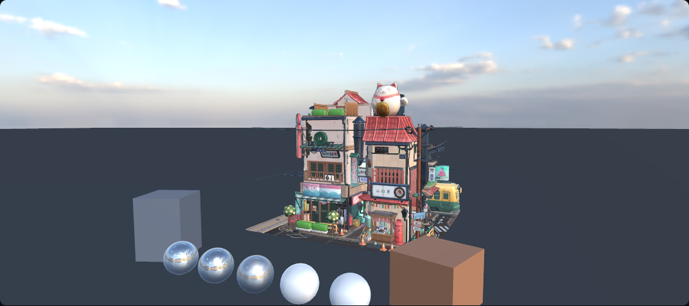

# GI Portfolio · WebGL2 实时 PBR / IBL 实验



用 WebGL2 / three.js 自建 pass 链的实时渲染作品集。当前完成 **三附件 G-buffer MRT + 自写 Cook-Torrance 直接光 + split-sum IBL + HDR 后处理 + CSM 阴影 + Forward-Clustered 多光源**，用 Cornell Box 做正确性参考、用 Poly Haven HDRI + LittlestTokyo 做真实资产验证。

> **状态边界**：当前是「直接光 + IBL + 阴影 + 多光源剔除」，**不是完整 GI**。SSR、GTAO / SSGI、烘焙 lightmap + SH 探针、DDGI、Sponza 室内场景仍在 roadmap 中，站点会明确标注；不把规划写成已完成。

## 演示入口

默认 `/d/hello-cube` 会进入 **演示模式**：只保留切场景、IBL 开关、白炉读数；右上角「技术模式」可展开完整 HDR / 性能 / G-buffer 面板。`/d/pbr-ibl` 默认就是 **户外 + IBL + ACES**，`/d/hello-cube` 保留 Cornell 参考场景；显式 query 可覆盖这两个默认值。

| 入口 | 用途 |
| --- | --- |
| `/d/pbr-ibl?scene=outdoor&env=1&tm=aces` | 户外 hero：1K HDRI + LittlestTokyo + IBL |
| `/d/pbr-ibl?scene=outdoor&env=0&presentation=1` | 同一机位的 IBL 关闭对照，打开后看金属球反射 |
| `/d/pbr-ibl?scene=cornell&furnace=1&presentation=1` | 白炉：环境纯白、直接光关闭、albedo 强制 1 |
| `/d/hello-cube?scene=outdoor&env=1&presentation=0` | 技术模式：G-buffer 调试 / HDR 链路 / 逐 pass 计时 |
| `/d/hello-cube?presentation=0&speed=0&clustered=1&lightCount=32` | 技术模式：Clustered 多光源与剔除归因；把 `clustered=0` 换成暴力前向对照组（暂无独立站点条目） |
| `?tm=aces` | 把默认线性输出切到 ACES；户外 hero 建议加上 |

截图中的机位：`城市`（hero）、`IBL 球列`（粗糙度扫掠特写）、`全景`、`低角度`，数字键 `1–4` 切换。

## 已实现

- **G-buffer MRT**：3 附件（gAlbedo / gNormal / gMRAO）+ 可采样深度；所有进入 beauty 的材质都写满 3 个 fragment output。
- **直接光 PBR**：GGX 法线分布 + Smith 几何遮蔽 + Schlick 菲涅尔；从真实 three.js 灯光同步主光参数。
- **IBL split-sum**：256² HalfFloat cube + mip 链；roughness→LOD、Karis EnvBRDFApprox；漫反射用高 LOD 平均 radiance × π 归一化。
- **阴影**：CSM 深度图集（1–4 级、默认 2048²）+ 自写 `shadowFactor()`（SM / PCF 5×5 / PCSS、三种 bias 可 A/B）；级联硬切、VSM、texel snapping 未做。
- **Forward-Clustered 多光源**：CPU 剔除 + 两张数据纹理；性能面板给出平均每 cluster 灯数、循环节省与剔除 CPU 耗时。`?clustered=0&lightCount=32` 即暴力前向对照组。**默认不挂灯阵**（`lightCount=0`），保证其他页面零回归。
- **真实资产**：Poly Haven CC0 HDRI（1K equirect）+ LittlestTokyo（CC BY 4.0，Draco，约 171k 三角形）；`SkeletonUtils` 克隆蒙皮、traverse 替换 `GBufferMaterial`、baseColor / alphaTest / side。
- **天空**：天空球直接采样 1K equirect HDR，显式写满 3 个 MRT 附件（不用 `scene.background`）。
- **白炉读数**：HUD 显示中心亮度 / 全帧几何均值 / 相对 1.000 的偏差；Playwright 在真实测光回读后校验。
- **演示模式**：默认隐藏调试 HUD；技术模式恢复 HDR 链路、性能面板、G-buffer 调试。
- **HDR 后处理**：RGBA16F → 自动曝光 / 直方图 / ACES / AgX / Bloom；旁路 A/B 与逐 pass 计时。
- **自动化验证**：22 个 Playwright 用例覆盖 HDR / G-buffer / 白炉 / 户外 IBL / 阴影 / Clustered / 演示模式 / 默认零回归。

## 渲染链路

```text
ShadowMapPass: 主光深度图集 / CSM ──┐
                                    ▼
three.js 场景（GBufferMaterial / SkyMaterial；自写 BRDF + IBL + Clustered 灯表）
        │
        ▼
BeautyPass: 3× MRT（gAlbedo 最终着色 / gNormal / gMRAO）+ depth
        │                         │
        │                         └─ G-buffer / 阴影 / cluster 调试视图
        ▼
HDRPipeline: luminance（测光 / 白炉读数）→ bloom → tonemap-output
        │
        ▼
canvas（sRGB）
```

自建链与场景直出共用同一批 GBufferMaterial；旁路路径用于像素级 A/B，证明后处理没有改变画面语义。

## 验证数据

2026-11-06 全量复跑（`npx playwright test`，headless Chromium / SwiftShader）：

| 项目 | 结果 |
| --- | --- |
| Playwright | **22 passed** |
| 白炉中心亮度 | **0.978**（**-2.20%**，目标 ±2%，略超） |
| 白炉全帧几何均值 | HUD 实时显示（含天空 / 暗部，不是 ±% 判据） |
| 户外 IBL 关 / 开 亮度均值 | 125.41 / 132.96 |
| 户外 IBL A/B | 平均差 **8.478**，差异 > 8 像素 **58.89%** |
| 自建链 vs 直出（Cornell） | 线性域平均差 **≈0.19**，> 8 像素 **≈0.25%** |
| 阴影 A/B | 平均差 **0.83**，> 8 像素 **0.55%**（确定性噪声 0.00） |
| Bloom A/B | 平均差 **≈59.89**，> 8 像素 **76.35%** |
| 构建 | 671 modules；合计 1,378.32 kB / gzip 397.44 kB（`index` 111.80 / `vendor` 572.64 / `three` 693.88 kB；后两者仍有 >500 kB 体积告警） |

这些是**回归指标**，不是画质评分；白炉读数会随材质的 roughness 变化，HUD 会显示当前粗糙度。像素级 A/B 在 SwiftShader 下有 ±0.01 级帧间噪声，上表为两次复跑的代表值（取约数）。以上均为软件渲染器数据，只用于守护回归，不是性能数据。

## 性能

**真机数据待采。** 开发 / CI 的 headless Chromium 使用 SwiftShader，**不能作为作品集性能数据**；下表故意保留空白，不用软件渲染器的数字冒充。

### 采集口径（先固定再测）

- 记录 **设备型号 / GPU / 浏览器版本 / 分辨率 / DPR**，每组至少 3 次取中位数。
- 固定机位与状态：`?presentation=0&speed=0`（技术模式、关巡航），等相机飞入收敛后再采样。
- 读右上角 PerfPanel 的逐 pass GPU ms（需 `EXT_disjoint_timer_query_webgl2`；不可用时降级为「连续 N 帧帧时间中位数」，并注明含 VSync 与合成开销，只能看相对趋势）。
- 每个对照只改一个变量；draw calls / 三角形 / 显存同时记录。

| 场景 | 分辨率 / DPR | Draw calls | 三角形 | GPU 总 ms | 备注 |
| --- | --- | --- | --- | --- | --- |
| Cornell（基线） | 待真机 | 待真机 | 待真机 | 待真机 | 8 个参考 mesh + 探针 |
| 户外 · IBL 关 / 开 | 待真机 | 约 79 | 约 171k | 待真机 | 只改 `env` |
| Bloom 关 / 开 | 待真机 | — | — | 待真机 | 只改 `bloom`；同时记 `bloom` pass 占比 |
| DPR 阶梯（1 / 1.5 / 2） | 待真机 | — | — | 待真机 | 带宽瓶颈证据 |
| 阴影 1 / 2 / 4 级 × 1024 / 2048 | 待真机 | — | — | 待真机 | 记 `shadow-map` pass |
| Clustered 灯数 0 / 8 / 32 / 56 | 待真机 | — | — | 待真机 | 同时记 `beauty` GPU ms 与 `cullCpuMs`；`?clustered=0` 为对照组 |

### 已有数据：SwiftShader 阶梯（仅看趋势，不可引用）

| 点光数 | 合计灯数 | 平均每 cluster | 循环节省 | 剔除 CPU |
| --- | --- | --- | --- | --- |
| 8 | 12 | 3.26 盏 | 72.7% | 2.40 ms |
| 32 | 36 | 5.30 盏 | 85.3% | 6.00 ms |
| 56 | 60 | 7.45 盏 | 87.6% | 5.90 ms |

**要如实讲的那一面**：剔除省下的是 GPU 侧逐片元循环（60 盏 → 平均 7.45 次），代价是每帧 2–6 ms 的 JS 剔除；在快显卡上 CPU 侧很可能反超收益，这正是阶段 4 迁 compute 的论据。不能只报「节省 87.6%」。真机数据出来后，把这一结论连同 `cullCpuMs` 一起写进 limitations。

首屏资产约 6 MB（HDR 1.12 MB + GLB 3.94 MB + Draco 解码器约 1 MB）。

## 资产与许可

- HDRI：**Poly Haven** `kloppenheim_06_puresky_1k.hdr`，CC0，<https://polyhaven.com/hdris>
- 模型：**LittlestTokyo**，Glen Fox / three.js，**CC BY 4.0**，<https://github.com/mrdoob/three.js/tree/dev/examples/models/gltf>
- Draco 解码器：Apache 2.0，来自 three.js
- 完整来源与用途：`public/assets/CREDITS.md`

LittlestTokyo 与 HDRI 是第三方资产，**不能声称原创**；公开部署时请保留署名与许可链接。代码本身目前未附 LICENSE（许可证尚待选定：MIT / Apache-2.0 / 保留所有权利），公开部署前应补齐；第三方资产的完整来源见 `public/assets/CREDITS.md`。

## 开发

```bash
npm install
npm run dev        # 本地开发
npm run typecheck
npm run smoke      # Playwright；截图写到 e2e/screenshots（不入库）
npm run build
```

`public/` 需要包含 `hdr/`、`assets/`、`draco/`；`docs/images/` 是 README / case study 用的整理稿截图。

浏览器要求：WebGL2；MRT / HDR 需要 `EXT_color_buffer_float`。不支持时降级单目标，G-buffer 选项隐藏；HDR cube 失败时 IBL 回退 RoomEnvironment，天空仍保留 equirect HDR。

## 目录

```text
src/core/postfx/        Pipeline、BeautyPass、HDR 链、GBufferMaterial / SkyMaterial、IBL 环境
src/core/scene/         CornellBox / OutdoorScene / GltfScene / SceneAsset
src/core/camera/        CameraRig（预设机位 / 数字键 / 巡航）
src/demos/hello-cube/   演示 Stage、HUD、演示模式、白炉读数
src/site/               demo 元数据与页面
e2e/                    冒烟、像素 A/B、白炉、演示模式测试
docs/images/            README 用截图
```

## 下一步

1. **真实 GPU 性能采样**：按上表口径补齐设备 / 分辨率 / DPR / 浏览器与逐 pass GPU ms；SwiftShader 数据不可引用。
2. **多光源展示与收口**：`light-ssr` 独立站点条目、S3-b 灯位手调、32 / 56 灯 A/B、面板文案定稿。
3. **SSR**：屏幕空间反射接入自建 pass 链，先复核 MSAA 下 `DepthTexture` 可采样性。
4. **WebGPU 冒烟**：在阶段 4 前验证 `WebGPURenderer` 能否承载现有 `Pipeline`（MRT / GPU 计时的等价物）。
5. **GI 主线**：Sponza 室内 → 烘焙 lightmap + SH 探针（probe 层按 DDGI 可复用设计）→ SSGI → DDGI；到那一步才把「GI」作为主标题。

## Case study

实现细节、三个关键 debug 故事（`uEnvMap` 命名导致环境贴图静默失绑、相机 target 未收敛、clearAlpha 泄漏）、设计取舍与局限见 [CASE_STUDY.md](CASE_STUDY.md)。
